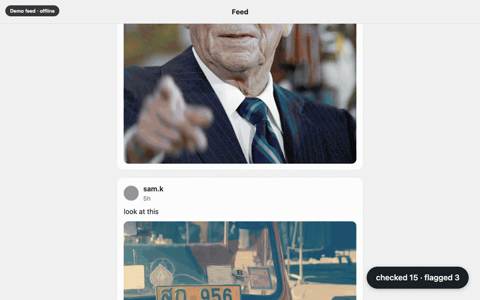

# Sidenote

**Grammarly for images.** Sidenote is a Chrome extension that checks the images you scroll past and only speaks up when one is a known fake or an edited version of a real photo. When it does, it puts a short note under the image saying what's actually going on, with a link to the fact-check.

**[Watch the 2-minute demo](https://drive.google.com/file/d/13o9enCaqyHx_e_lahNhgkOggq3qEZV8j/view)**



Built at c0mpiled-16, UC San Diego, October 2026 (Track 4: AI-Powered Consumer Products for 1 Billion People).

## What you see

- **Known fake:** a note under the image saying what it really is and where it came from, with a link to the source.
- **Edited real photo:** the same note, plus the real original next to the shared copy with the edited area outlined.
- **Wrong note?** Every card has a "Wrong match?" link. It hides the card and logs a report for a person to review.
- **Everything else:** nothing. A real photo of the same event, person or flood stays silent.

It works on any site. X and Reddit get card placement tuned to their layouts. Everywhere else (news articles, Wikipedia, blogs) the card goes right under the image.

## Why

Most viral fakes have already been fact-checked by someone. The problem is that the fact-check stays stuck on one post. A Community Note lives on X. A Snopes article lives on Snopes. Screenshot the image, repost it on Reddit or in the family group chat, and the correction is gone.

Sidenote makes the note travel with the image. It doesn't decide what's true; people already did that. It recognizes the same image after it's been cropped, screenshotted, recompressed or captioned, and brings their verdict along.

## Invisible by design

There's no app to open and nothing to click. Sidenote lives inside the feeds you already scroll.

- **No input.** You never paste a link, right-click an image or open a popup. Checking happens as images come on screen.
- **Silent by default.** On almost everything you see, it does nothing at all. In testing it flagged 0 of 5,236 normal photos.
- **Shows up at the right moment.** The note appears under the image right when you're about to believe it or share it, not later on some other site.
- **No account, no setup.** Install it and keep browsing.

## How it works

```
on-screen   ->  content.js  ->  background.js  ->  /match (FastAPI, localhost)
                                                          |
                                         pHash, then SSCD copy-detection embedding
                                         vs. an index of fact-checked images
                                                          |
                                         edited pair? compare the edited region
                                         to the fake and to the real original
                                                          |
                     note card  <-  match + fact-check  <-+
```

- **Only what's on screen.** Images get checked when they're on screen or about to be. The page is never scanned as a whole.
- **Matches the picture, not the topic.** Matching uses [SSCD](https://github.com/facebookresearch/sscd-copy-detection), a model trained to recognize an image after crops, overlays and recompression. General image models match on topic and would flag every photo of a shark. SSCD matches the actual picture.
- **Reposts baked into the index.** Each fact-checked image is stored as 8 versions: the original plus 7 that copy how people repost (crops, a phone screenshot frame, a caption bar, low-quality JPEG, a mirror). That makes matching more forgiving at no extra cost per lookup.
- **Edited photos.** When we have the real original, Sidenote works out which pixels the edit changed, then judges each new copy by those pixels only. A repost of the real photo stays silent even though it's nearly identical to the fake.

The full design, with diagrams, is in [docs/DESIGN.md](docs/DESIGN.md).

## Numbers

From `backend/eval.py`, 53 fact-checked images, everything on CPU:

| | |
|---|---|
| Reposts caught (random crops, rotation, filters, captions, screenshots, heavy JPEG) | 152/159 |
| Real reposts collected from the web | 21/26 |
| Edited fakes caught / real originals wrongly flagged | 83/90 / 1/90 |
| Normal photos wrongly flagged (236 hand-picked, many of the same subjects as the fakes, + 5,000 COCO) | 0/5,236 |
| Time per image | ~60 ms median |
| Cost | $0, runs locally |

## Run it

Requires Python 3.12 and Chrome. From the repo root:

```bash
python -m venv .venv
.venv/bin/pip install -r backend/requirements.txt
mkdir -p weights
curl -L -o weights/sscd_disc_mixup.torchscript.pt \
  https://dl.fbaipublicfiles.com/sscd-copy-detection/sscd_disc_mixup.torchscript.pt

cd backend
../.venv/bin/python build_index.py              # seeds/ -> index/
../.venv/bin/python -m uvicorn app:app --port 8000
```

Then open `chrome://extensions`, turn on Developer mode, click **Load unpacked**, and pick the `extension/` folder.

**Seed images** aren't in the repo (they belong to their photographers and publishers). Each `seeds/<id>/meta.json` has the claim, the verdict and the fact-check link. Put the image next to it as `image.jpg`, and for edited photos put the real one there as `original.jpg`.

**Demo feed and eval** use local test photos that also aren't in the repo: normal photos in `test/negatives/`, real reposts in `test/wild/<id>/`, and [COCO val2017](https://cocodataset.org/#download) in `test/coco/`. From `backend/`:

```bash
../.venv/bin/python make_demo.py    # builds demo/feed/
../.venv/bin/python eval.py         # recall, false flags, latency
```

With the server running, open `http://localhost:8000/demo/?demo`. It's a fake social feed with reposted fakes mixed in among normal photos. The counter in the corner shows how many images were checked and how many got a note. On other sites, Alt+Shift+F (Option+Shift+F on Mac) toggles it.

## Layout

```
extension/   content.js (find on-screen images, place the card), background.js (queue, cache, backend calls), card.css
backend/     app.py (API), matcher.py, embed.py (SSCD), edit_diff.py (edited-photo check),
             augment.py, build_index.py, eval.py, make_demo.py, match.py (match images from the command line)
seeds/       one folder per fact-checked image: meta.json (+ image.jpg, original.jpg locally)
demo/        offline demo feed
docs/        DESIGN.md, demo.gif
```

## Limits and what's next

- **Coverage.** 53 hand-picked fact-checks today. Next is pulling them in automatically from ClaimReview (the markup fact-checkers already attach to their articles) and from Community Notes public data.
- **Privacy.** Right now every image you scroll past gets sent to the local backend. A hosted version would keep a compact index inside the extension and only ask the server when there's a likely match, the way Safe Browsing checks URLs.
- **Brand-new fakes.** Sidenote only knows fakes someone has already checked. That covers repeat spread, which is where most of the damage happens.
- **Collages.** When the fake is one small tile in a grid of images, the match can be missed.
- **Video.** Not yet. Keyframes would go through the same index.
