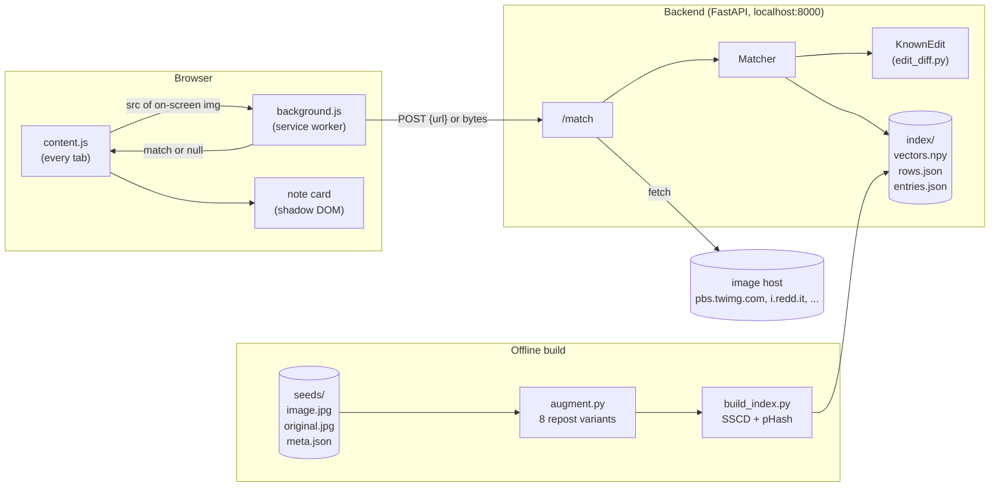
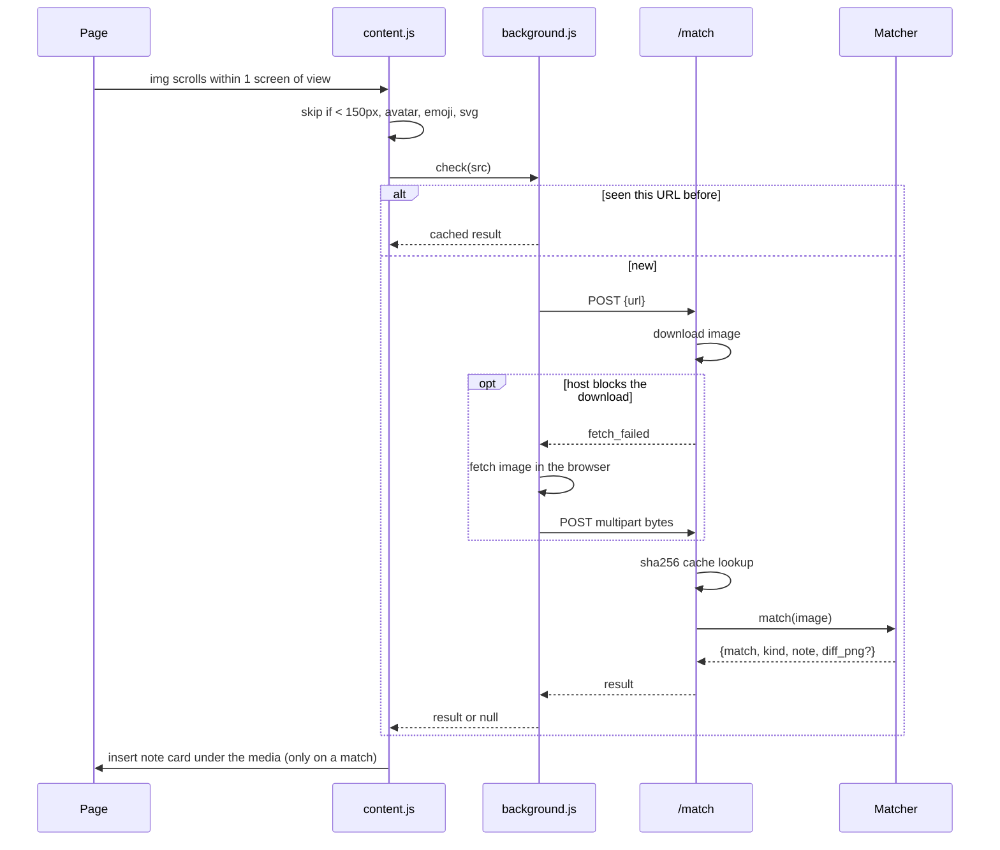
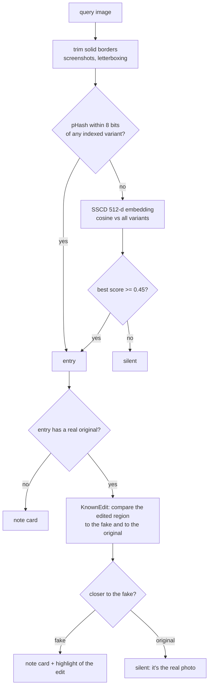
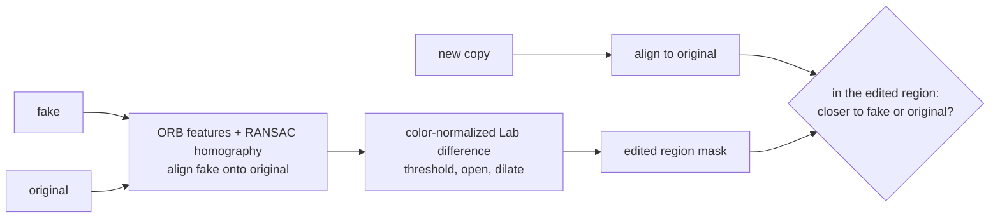
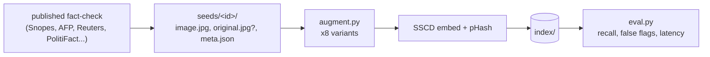
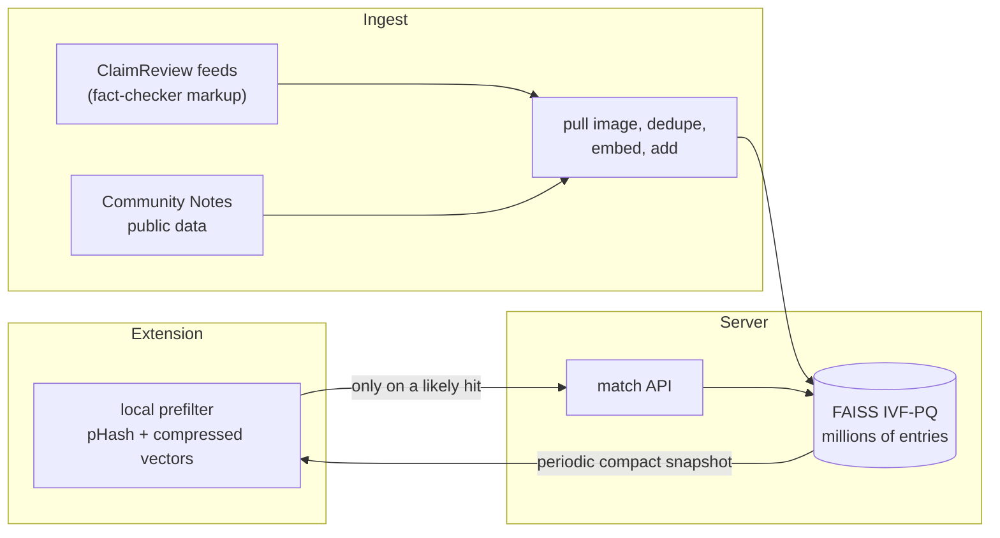

# Sidenote: system design

Sidenote is a browser extension that recognizes images people have already fact-checked and puts a short note under them, wherever they show up. It never decides on its own whether an image is fake. Every note comes from a published fact-check.

## 1. Components

| Part | Job | Why it's built this way |
|---|---|---|
| `content.js` | Watches `` tags with an IntersectionObserver, checks the ones on or about to come on screen, and places the card | Never scans the whole page. Each image costs one request, and only when you can actually see it |
| `background.js` | Queues requests (3 at a time), caches by URL, falls back to sending the image bytes when the backend can't download it | Content scripts can't make cross-origin requests to localhost. The queue keeps fast scrolling from flooding the backend |
| note card | Shadow DOM element inserted after the post's media block | The site's CSS can't break it and it can't break the site |
| `/match` | Gets the image, caches by SHA-256 of the bytes, runs the matcher | The same viral image shows up under many URLs. The byte hash dedupes them |
| `Matcher` | pHash first, then SSCD embedding search, then the edited-pair check | Cheap exact check first, then the robust one |
| `/report` | "Wrong match?" on a card hides it and logs the image URL and seed id | Someone reviews every report. The matcher never learns from clicks, so nobody can game it into silencing a real fact-check |
| `KnownEdit` | For an edited fake that has its real original: finds the region that was changed and judges which version a new copy came from | Without this, a copy of the real photo would get flagged as the fake |

## 2. Life of one image

## 3. Matching decision

- **SSCD** (Meta's self-supervised copy detection model, ResNet-50, 512-d) is trained to match an image to edited copies of itself: crops, overlays, recompression, color shifts. That's the exact problem here. General-purpose embeddings like CLIP match on *topic*, so they'd flag every photo of a shark on a highway.
- **Threshold 0.45.** The highest-scoring normal photo out of 5,236 is 0.31. The band between 0.40 and 0.45 holds other images from the same AI generation batch as a known fake (0.42 to 0.43 on the Midjourney pope set). They were never fact-checked, so they stay silent.
- **Index-time augmentation**: every seed is stored as 8 variants (crops, half-size JPEG, caption bar, phone screenshot frame, mirror). Making the index robust costs nothing at query time.
- **Exact search** with numpy over L2-normalized vectors. That's the same math as FAISS `IndexFlatIP` and it's fine at this scale. We dropped FAISS because faiss and torch each bundle libomp on macOS and crash together. Past ~100k images, we'd move to FAISS IVF-PQ in its own process.

## 4. Edited photos

The edited region is computed once, when the index loads. A new copy is aligned to the original, and each pixel inside that region votes for whichever version it's close to. Crops, filters and captions change the rest of the image, so they don't matter. Pixels that look like neither version, or that are covered by a solid caption bar or sticker, get no vote. A verdict needs a clear majority. If there's no clear majority, the matcher falls back to comparing embedding similarity with a margin, and when it's still unsure it stays silent. Calling a real photo fake is the worst mistake this product can make, so every tie goes to silence.

## 5. Offline build

## 6. Numbers

`eval.py` measures three things:

- **Synthetic reposts** of every seed: random crops, rotation, color shifts, caption text, screenshot frames, JPEG quality 30 to 70. None of these are the transforms used at index time.
- **Real reposts found online**: tweet screenshots, fact-check frames with stamps, captioned thumbnails, news article crops.
- **Normal photos**: 236 hand-picked ones (148 show the same subject as a fake), plus the 5,000 COCO val2017 images.

| | |
|---|---|
| Seeds | 53 (9 edited pairs with the real original) |
| Synthetic reposts caught | 152/159 (96%) |
| Real reposts from the web caught | 21/26 |
| Edited fakes caught / real originals flagged | 83/90 / 1/90 |
| Normal photos flagged | 0/5,236 |
| Highest normal-photo score | 0.31 vs threshold 0.45 |
| Latency | ~60 ms median, ~100 ms p95, CPU only |
| Cost | $0, everything runs locally |

The real reposts it misses are collages where the fake is a small tile, and different images from the same AI series as a seed (they're separate images, so they *should* need their own entry).

## 7. Going to production

What's built today runs on localhost with a hand-curated seed set. These are the two things that would have to change before real users:

- **Privacy**: right now every image you scroll past gets sent to the backend. In production the extension would hold a compact local index and only ask the server on a likely hit, the same way Safe Browsing checks URLs.
- **Coverage**: seeds come from fact-checks already published in machine-readable form, mainly ClaimReview markup that fact-checkers attach to their articles and Community Notes public data, instead of being hand-picked.
